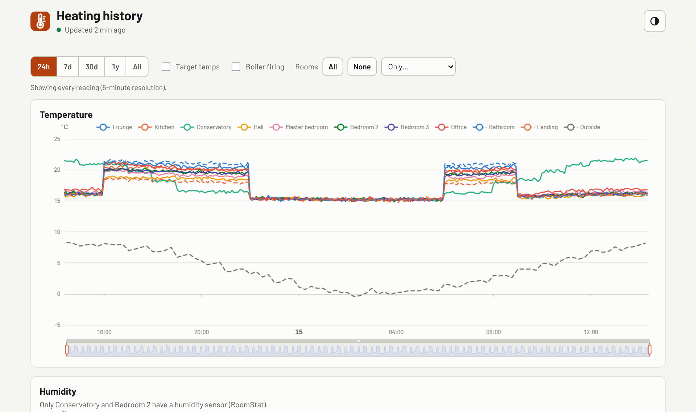
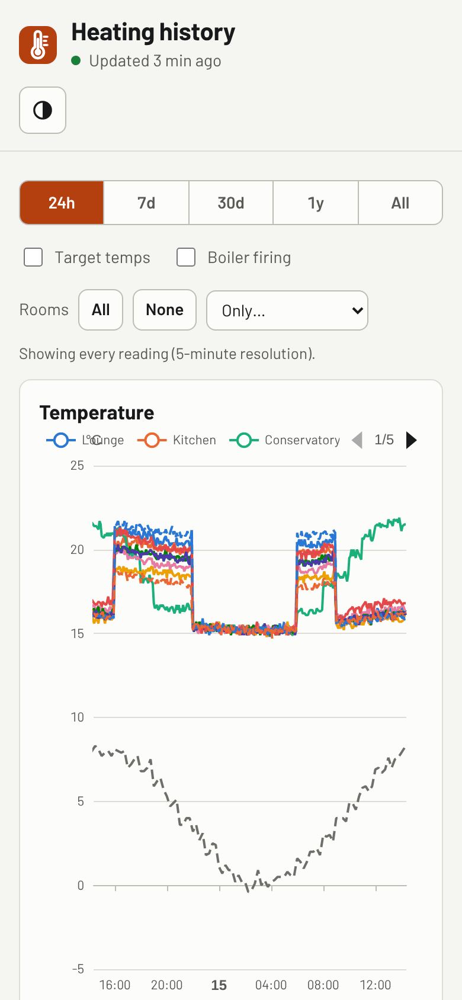

# Wiser heating history

<picture>
  <source media="(prefers-color-scheme: dark)" srcset="docs/screenshots/desktop-dark.png">
  
</picture>

Records Drayton Wiser heating data plus local weather every 5 minutes, and serves
an interactive site for exploring years of it.

## What it does

Two components, deliberately decoupled. They share only the published data files,
so either can be rewritten without touching the other:

| | What it does |
|---|---|
| **`collector/`** | Polls the Wiser hub and OpenWeatherMap, back-fills hourly weather from Open-Meteo and half-hourly gas and electricity from the smart meter, stores everything in SQLite, generates the static data files, mirrors them to a private S3 bucket |
| **`web/`** | nginx serving a single-page ECharts site that reads those files |

The website:

- **Range buttons** (24h / 7d / 30d / 1y / All) plus drag, scroll-wheel and pinch zoom.
  The resolution follows the zoom: zoom a year view into a week and it switches from
  daily averages to every 5-minute reading. A note under the buttons says which is showing.
- **Temperature and humidity** are two charts, not one with two y-axes (different scales
  in one plot invite false correlations). They're **linked**: one zoom, and the same rooms
  shown in both.
- **Rooms:** click a legend entry, or use **All**, **None** or **Only…**.
- **Target temperatures** and **boiler firing** overlays; collection gaps are drawn as gaps.
- **Rooms table** for the period on screen: latest, average, lowest, highest, *widest day*
  (largest swing within one day) and humidity, sortable.
- Light and dark (Auto / Light / Dark), and an **Updated** line that turns amber then red
  if collection stalls.

Colour uses eight categorical hues validated for colour-vision deficiency in both
modes. With ten rooms, the last two reuse the first two hues with a dashed stroke.
Hue is bound to room id, so a room keeps its colour whichever others are hidden.

It follows my shared app standard (shared look, GitHub Actions → ghcr.io → Docker; see
[How this was built](#how-this-was-built)).

## On a phone

<picture>
  <source media="(prefers-color-scheme: dark)" srcset="docs/screenshots/phone-dark.png">
  
</picture>

The screenshots show made-up data from `scripts/demo_data.py`. They follow your GitHub theme, light or dark, like the app itself.

## Why

It replaces `/opt/wiser_logging`, which failed on **every run for years** without
anyone noticing, because its cron entry ended `>/dev/null 2>&1`. Several choices
here are direct responses to that:

| Decision | Reason |
|---|---|
| No third-party Wiser library | The predecessor died when `wiserHeatingAPI` was abandoned. The hub is one JSON GET with one header |
| Containers with internal schedulers | No root cron, no discarded stderr, no venv to break on the next distro upgrade |
| `run_log` row every cycle + `/metrics` | Silent death becomes visible. A crash-only alert would not have caught the original |
| Rooms keyed on hub id, never name | A rename would otherwise fragment the history silently |
| UTC everywhere | The hub reports `TimeZoneOffset: 0` while sitting in BST |
| Weather responses scrubbed | OWM embeds the API key in the `prev`/`next` URLs it returns |
| A second, hourly weather source | OWM can't be back-filled: weather not captured at the time is gone. Open-Meteo has history, and measured sunlight |
| `botocore` pinned below DEBUG | That logger put an AWS key id into the old world-readable `wiser.log` |

The room-id decision has since proved itself: two rooms were renamed in August
2026 and both kept a single unbroken series across the change.

## Set up (Docker)

You need Docker and a login to GitHub's container registry while the image is
private (`docker login ghcr.io` with a `read:packages` token).

1. **Create folders and config.**
   ```bash
   sudo mkdir -p /srv/wiser /opt/appdata/wiser
   sudo chown -R 1003:1006 /opt/appdata/wiser          # PUID:PGID from .env
   cd /srv/wiser
   # copy docker-compose.yml and .env.example from this repo, then:
   sudo install -m 600 /dev/null .env                  # create locked down, THEN fill in
   ```
2. **Start it.**
   ```bash
   sudo docker compose pull && sudo docker compose up -d
   sudo docker compose logs -f
   ```

Two containers come up: `wiser-collector` (metrics on **:9109**) and `wiser-web`
(the site on **:5059**). Both run as 1003:1006.

State lives in `/opt/appdata/wiser`:

```
wiser.db              source of truth
published/data/       the JSON the website reads
published/backup/     gzipped DB, mirrored to S3
```

The web container mounts `published/` **read-only**, so the site renders the data
and can never alter it. nginx serves only `published/data/`; everything else there,
including the database backup, returns 404. S3 holds a private off-site copy. The IAM user has
`PutObject` and nothing else, so a misbehaving collector cannot read or destroy
its own backup.

### Updating

```bash
cd /srv/wiser && sudo docker compose pull && sudo docker compose up -d
```

### Access

The site is on port **5059** on the LAN and over Tailscale. It has no login. This is
occupancy data (it shows when nobody is home), so don't expose it to the internet
without Cloudflare Access in front.

## Configuration

Every setting is in [.env.example](.env.example), with its default and a one-line
explanation: the Wiser hub address and secret, the OpenWeatherMap key, AWS credentials
and bucket, the poll cadences, the Open-Meteo sync (on by default, no key), and `PUID`/`PGID` (default 1003/1006, the same as my
other containers; `/opt/appdata/wiser` must belong to them).

### Weather data

Two sources, kept in separate tables because they answer different questions:

| Table | Source | Every | What it adds |
|---|---|---|---|
| `weather` | OpenWeatherMap One Call 4.0 | 15 min | Live conditions, including `rain_1h_mm` and `snow_1h_mm` (since 1.2.0; 0 when dry, NULL before then) and the condition code |
| `weather_hourly` | [Open-Meteo](https://open-meteo.com/en/docs/historical-weather-api) | hourly | Measured sunlight (`shortwave_wm2`, `direct_wm2`, `diffuse_wm2`), rain, snowfall (cm), cloud, wind, temperature and humidity, **back-filled from the day logging began** |

Open-Meteo is free for non-commercial use and needs no key. The collector syncs it
every 6 hours, using the location the hub reports:

- **`archive`** rows come from reanalysis data, which is final but a few days behind.
  Each sync asks only for the days that aren't complete yet.
- **`forecast`** rows fill the most recent days from the forecast API, up to the
  current hour (never a forecast of the future). An archive row always replaces a
  forecast row; a forecast row never replaces an archive row.

Hour labels are UTC. Temperature, humidity, cloud and wind are the values **at** that
time; radiation is the mean, and rain and snow the total, over the **preceding** hour.

A failed sync never affects the hub poll. It's retried an hour later and shows up as
`wiser_openmeteo_up 0`.

### Energy data (smart meter)

Optional: set `GLOW_USERNAME` and `GLOW_PASSWORD` to your login for Hildebrand Glow's free
**Bright** app. Bright reads any smart meter on the national smart-meter network (DCC), so this
works whoever the supplier is. The collector stores half-hourly `gas.consumption` and
`electricity.consumption` (kWh) in `energy_halfhourly`:

- `ts_utc` is the **start** of the half-hour. Missing half-hours aren't stored; a stored 0 is a real zero.
- First sync with data: reads every 10-day stretch of the last ~13 months once (10 days is the
  most the API accepts per request), whatever empty months lie in between. Later syncs, every
  6 hours, re-read the last 3 days (the meter network can deliver late).
- Until Bright has any data, each sync costs one request per meter.
- A request that fails in a way that might pass (dropped connection, timeout, HTTP 429 or 5xx)
  is retried once after 5 seconds; other errors fail straight away. The log line reports new
  readings separately from ones re-read and rewritten unchanged.
- **Gap-filling:** Bright fetches older history from the meter network bit by bit, so a stretch
  read with holes may be complete a day later. Each sync re-reads up to 6 incomplete 10-day
  stretches per meter, least recently tried first and, among those, newest first. A stretch older than 45 days that is still
  incomplete after 6 reads is left alone (those half-hours were never recorded), but still
  counted in `wiser_glow_missing_halfhours`. Missing readings are never filled in with guesses;
  analysis uses complete days only.

Gas turns boiler hours into energy; with a combi boiler it also includes hot water. Electricity
shows any electric heaters used alongside the radiators. A failed sync never affects the hub
poll, is retried after an hour, and shows as `wiser_glow_up 0`.

### Data tiers

The site picks a tier from the visible range, and switches as you zoom, so a ten-year view fetches one small
file rather than a million points:

| Range | File | Resolution |
|---|---|---|
| < 7 days | `data/raw/YYYY-MM.json` | native 5-minute |
| 7–90 days | `data/30min/YYYY.json` | half-hourly means |
| > 90 days | `data/daily/all.json` | daily min/max/mean |

`data/meta.json` carries the room list, rename history, coverage, known gaps,
last success, and both cadences.

> The hub is polled every 5 minutes but weather only every 15. Gap detection must
> use each series' **own** interval — checking weather against the hub's cadence
> marks every weather point as a gap and the outside line disappears entirely.
> That is what `weather_seconds` in `meta.json` is for.

## Monitoring

`http://<host>:9109/metrics` exposes Prometheus metrics, scraped by VictoriaMetrics:
`wiser_build_info`, `wiser_last_success_timestamp_seconds` (alert when `time() -` it
exceeds ~1800), `wiser_hub_up`, `wiser_weather_up`, `wiser_publish_up`,
`wiser_openmeteo_up`, `wiser_openmeteo_last_success_timestamp_seconds`, `wiser_glow_up`,
`wiser_glow_last_success_timestamp_seconds`,
`wiser_glow_latest_reading_timestamp_seconds{classifier="…"}` and
`wiser_glow_missing_halfhours{classifier="…"}` (only when the smart meter is set up), `wiser_cycles_total` and `wiser_failures_total`. Grafana also alerts on the weather
API and the S3 publish failing, and on the Open-Meteo sync going 12 hours without a success.

`/healthz` on the collector returns 503 once the last success is over 30 minutes old,
and the container healthcheck uses it. The web container's healthcheck just checks
nginx answers.

### Gaps

Missing readings are **never interpolated**. `meta.json` lists detected gaps and
the site draws them as breaks in the line, so an outage looks like an outage.
Given this project's history of failures hiding in plain sight, the chart should
make them more visible, not less.

## Development

```bash
pip install -r requirements-dev.txt
python -m pytest

# made-up data (10 rooms, 60 days, one outage) for trying the site with no hub
python scripts/demo_data.py /tmp/wiser-demo
# then serve web/ with /tmp/wiser-demo/published linked in as published/, and
# ECharts 5.5.1 at vendor/echarts.min.js (the Dockerfile fetches it at build time)
```

The logo is `web/icon.svg`; it's also the favicon. After changing it, regenerate the
icon set: `pip install cairosvg pillow && python scripts/make_icons.py --name "Heating history" --short "Heating" --accent "#b4400f"`.

Pushing to `main` runs the tests and publishes two images to ghcr.io:
`wiser-history-collector` and `wiser-history-web`.

## Files

```
docs/screenshots/      the pictures in this README (light and dark, desktop and phone)
collector/config.py    environment parsing, validated at startup
collector/hub.py       Wiser hub client + response parsing
collector/weather.py   OpenWeatherMap One Call 4.0 client (scrubs the API key)
collector/openmeteo.py Open-Meteo hourly back-fill and top-up
collector/glow.py      smart-meter gas and electricity via Bright (Glowmarkt API)
collector/store.py     SQLite schema, writes, and the rollup queries
collector/publish.py   static file generation + S3 upload
collector/main.py      scheduler, metrics endpoint, cycle orchestration
Dockerfile             the collector image

web/index.html         the page
web/app.js             charts, zoom-driven tier switching, linked charts, room table
web/app.css            accent, chart palette (light + dark), panels and table
web/gomez-ui.css/.js   the shared look (copied unchanged from my shared app standard)
web/icon.svg + icons   logo and favicon set
web/nginx.conf         static serving, cache policy, MIME types
web/Dockerfile         vendors ECharts at build time (no CDN at runtime), stamps the version

docker-compose.yml     what runs on the server (/srv/wiser)
scripts/               demo_data.py, make_icons.py
tests/                 pytest
```

## How this was built

This is one of several self-hosted apps I run at home. The code was written by Claude (an AI coding agent) under my direction. My part was the requirements, the standards, the review and the decisions:

- **Requirements first.** Functional and non-functional requirements were agreed as tickets in Obsidian before any code was written.
- **One shared standard.** All my apps share one look, one repo layout and one build-and-deploy pipeline (GitHub Actions → GitHub Container Registry → Docker Compose). `gomez-ui.css` and `gomez-ui.js` are the shared UI kit from that standard; gomez is my home server's name.
- **Reviewed before merging.** Every change came in as a pull request, with screenshots at desktop and phone widths in light and dark mode, and was merged only after I'd reviewed it and the tests passed.

More on how I work this way: [my GitHub profile](https://github.com/nick-a-louse).

## Licence

[MIT](LICENSE). Fonts are Barlow and Barlow Condensed under the SIL Open Font License (see the `OFL.txt` next to them).
