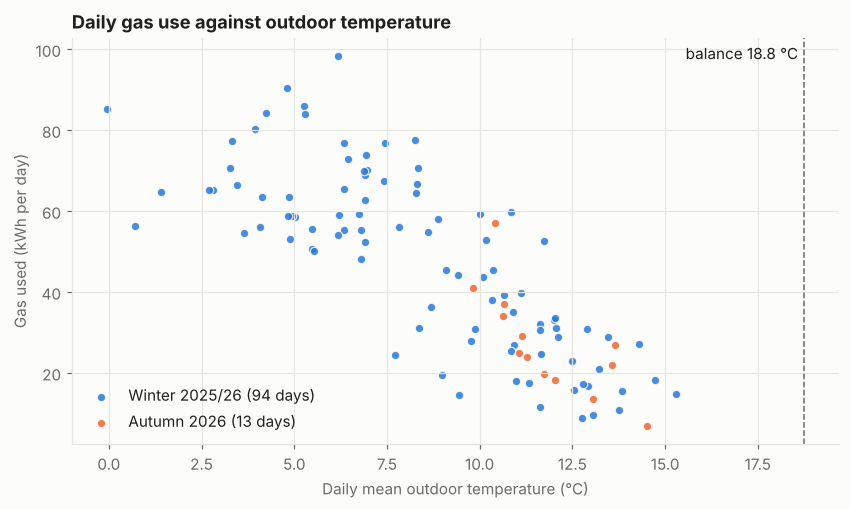
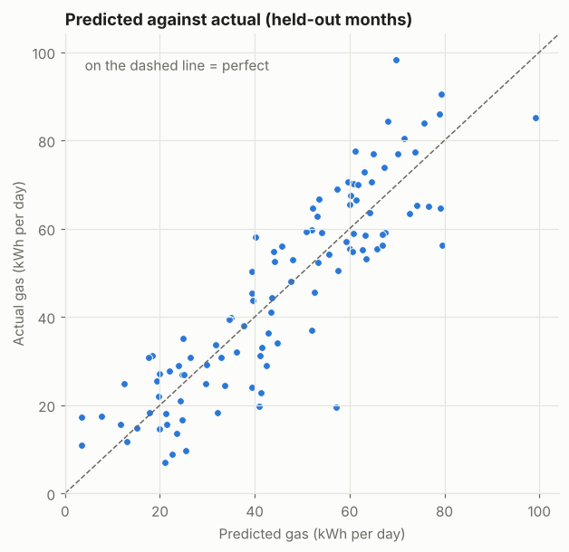
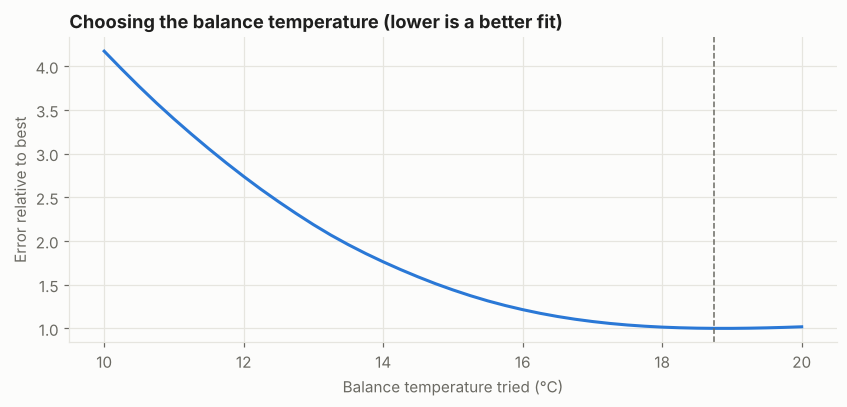
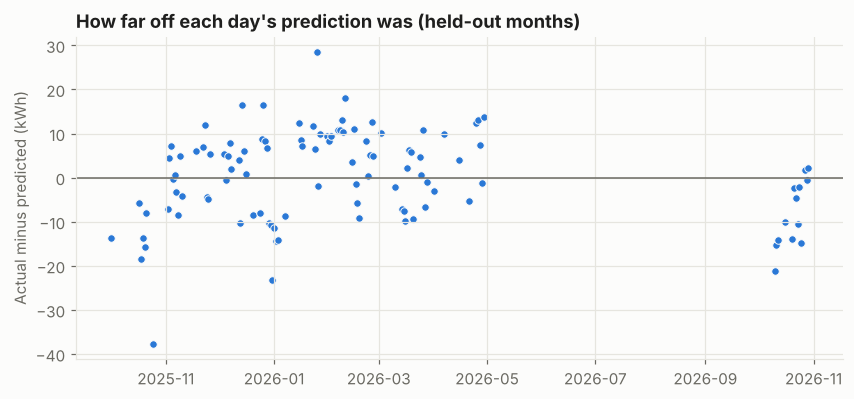

# Results: whole-house energy signature

*Generated October 2026 from the collector's database by `analysis/make_results.py` (TECH-98). Summary figures only: day-by-day data stays out of the repo. Terms are explained in the [glossary](../GLOSSARY.md); the method is in [`01_energy_signature.ipynb`](../01_energy_signature.ipynb).*

**Question:** how much gas should the house burn on a given day, for the weather? The answer describes the house in a few physical numbers, and is the yardstick for measuring changes such as new blinds or a lower flow temperature.

## Data

- **107 complete heating-season days** (all 48 half-hours of gas), Oct 2025 to Oct 2026. Days with any missing half-hour are left out, never guessed.
- **Days away are left out**: the model predicts a normal day at home. Left out: Tue 06 Oct 2026.
- **Hot water is measured, not guessed**: about **3.5 kWh/day** (typically 2.2 to 5.2), from 15 warm days with the heating off. The model's own estimate was poor, so it's fixed at this value.
- Weather: Open-Meteo hourly temperature, wind and sunshine.

| Month | Complete gas days | Average outdoor temp (°C) |
|---|---:|---:|
| Sep 2025 | 1 | 15.1 |
| Oct 2025 | 7 | 12.2 |
| Nov 2025 | 15 | 9.3 |
| Dec 2025 | 19 | 7.6 |
| Jan 2026 | 13 | 5.0 |
| Feb 2026 | 17 | 7.9 |
| Mar 2026 | 14 | 8.6 |
| Apr 2026 | 9 | 11.5 |
| May 2026 | 4 | 15.9 |
| Sep 2026 | 15 | 17.7 |
| Oct 2026 | 14 | 13.1 |

## The energy signature

Colder days use more gas, in a roughly straight line, down to a floor of hot-water use on warm days. The dashed line is the learned balance temperature.

## How well the models predict

Each month was held out in turn, and the model trained on the other months predicted it.

| Model | Typical miss (MAE, kWh/day) | CV(RMSE) | Bias (NMBE) |
|---|---:|---:|---:|
| Every day is average (baseline) | 21.2 | 53% | -1.1% |
| Degree-days at 15.5 °C | 11.5 | 31% | -3.6% |
| Degree-days at a learned balance temperature | 11.4 | 30% | +0.2% |
| Plus wind, sunshine and weekends | 8.5 | 23% | -0.3% |

## What the model learned (full model)

| Term | Meaning | Estimate | 95% confidence interval |
|---|---|---:|---:|
| hot water | Fixed at the measured level, kWh/day | 3.54 | (measured) |
| hdd | kWh per degree-day of cold | 4.59 | 4.24 to 4.95 |
| hdd_x_wind | Extra kWh per degree-day per m/s of wind above 4 | 0.24 | 0.10 to 0.38 |
| solar_kwh_m2 | kWh per kWh/m² of sunshine | -4.11 | -5.13 to -3.09 |
| weekend | Extra kWh on a weekend day | 13.94 | 9.10 to 18.77 |

Balance temperature: **18.75 °C** (best of a grid search from 10 to 20 °C):

## In plain English

- Heating is needed below about **18.8 °C** outside (daily average).
- Each degree-day of cold costs about **4.6 kWh** of gas, a heat-loss coefficient of roughly **168 W/K** (assuming 88% boiler efficiency; approximate).
- Hot water: about **3.5 kWh/day** on a normal day at home; none when away.
- **Wind** adds heat loss when it's cold: 10 degree-days with 5 m/s more wind costs about **12 kWh** extra.
- **Sunshine** saves about **4.1 kWh** of gas per kWh/m².
- **Weekends** use about **+14 kWh/day** compared with weekdays in the same weather (people at home, heating on longer).
- Electricity use vs the gas the model can't explain: correlation **-0.05**, so no clear sign at whole-house level of the electric heaters standing in for gas.

## Month by month (held out)

| Month | Days | Typical miss (kWh/day) | Bias (NMBE) |
|---|---:|---:|---:|
| Oct 2025 | 7 | 16.1 | +93% |
| Nov 2025 | 15 | 5.3 | -2% |
| Dec 2025 | 19 | 8.4 | -1% |
| Jan 2026 | 13 | 11.2 | -5% |
| Feb 2026 | 17 | 8.4 | -11% |
| Mar 2026 | 14 | 6.0 | +0% |
| Apr 2026 | 9 | 7.8 | -31% |
| Oct 2026 | 13 | 8.8 | +30% |

Positive bias means the model predicted **more** gas than was used.

## The days the model got most wrong

**More gas than the weather explains**

| Day | Actual (kWh) | Predicted (kWh) | Difference | Outside (°C) | Wind (m/s) | Sun (kWh/m²) |
|---|---:|---:|---:|---:|---:|---:|
| Sun 25 Jan 2026 | 98.3 | 69.7 | +28.6 | 6.2 | 3.5 | 0.7 |
| Tue 10 Feb 2026 | 58.2 | 40.1 | +18.0 | 8.9 | 2.5 | 0.8 |
| Sun 14 Dec 2025 | 77.6 | 61.2 | +16.4 | 8.2 | 4.3 | 0.9 |
| Fri 26 Dec 2025 | 84.4 | 68.0 | +16.4 | 4.2 | 3.8 | 0.6 |
| Wed 29 Apr 2026 | 17.3 | 3.5 | +13.7 | 12.8 | 6.0 | 7.0 |
| Sun 26 Apr 2026 | 30.7 | 17.6 | +13.1 | 11.6 | 2.5 | 5.9 |

**Less gas than the weather explains**

| Day | Actual (kWh) | Predicted (kWh) | Difference | Outside (°C) | Wind (m/s) | Sun (kWh/m²) |
|---|---:|---:|---:|---:|---:|---:|
| Sat 25 Oct 2025 | 19.4 | 57.2 | -37.8 | 9.0 | 4.5 | 2.0 |
| Wed 31 Dec 2025 | 56.3 | 79.6 | -23.2 | 0.7 | 2.5 | 1.0 |
| Sat 10 Oct 2026 | 19.7 | 41.0 | -21.3 | 11.7 | 4.5 | 3.0 |
| Sat 18 Oct 2025 | 22.9 | 41.4 | -18.5 | 12.5 | 2.7 | 1.5 |
| Mon 20 Oct 2025 | 9.8 | 25.5 | -15.7 | 13.0 | 3.6 | 1.4 |
| Sun 11 Oct 2026 | 24.1 | 39.4 | -15.3 | 11.3 | 2.3 | 2.8 |

## Caveats

- Whole house only; room-by-room heat loss is the next step (needs the floor plan).
- Gas includes hot water (combi boiler), which adds day-to-day noise the weather can't explain.
- The start of each heating season is fuzzy: in early October the heating may not be on yet.
- The heat-loss coefficient is for before/after comparisons, not for comparing with other houses.
- Predictions never go below the hot-water level (sun can offset heating, not hot water).
- The balance temperature and the hot-water level trade off: fixing hot water at the measured, lower level moved the balance point up. Treat it as approximate; the slope, wind, sun and weekend effects were stable either way.
- Days away with some gas still used (e.g. frost protection) need listing in `analysis/data/away_days.txt`, or they look like unusually efficient days.
