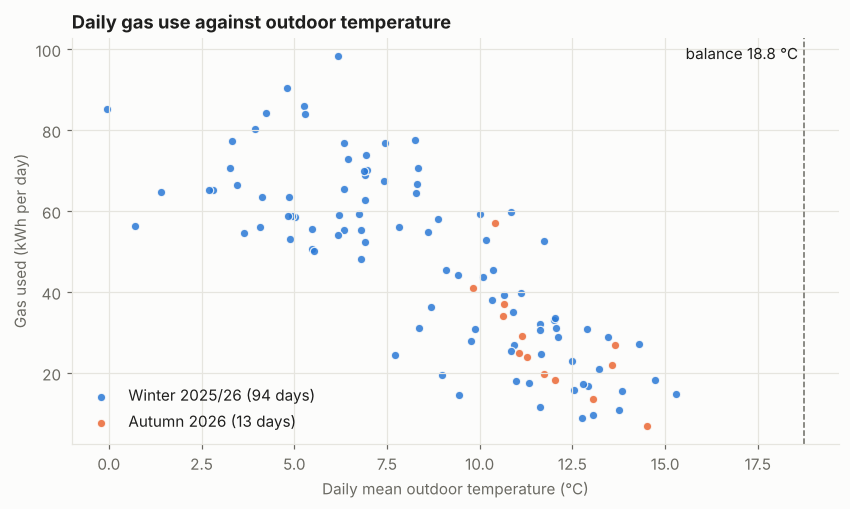
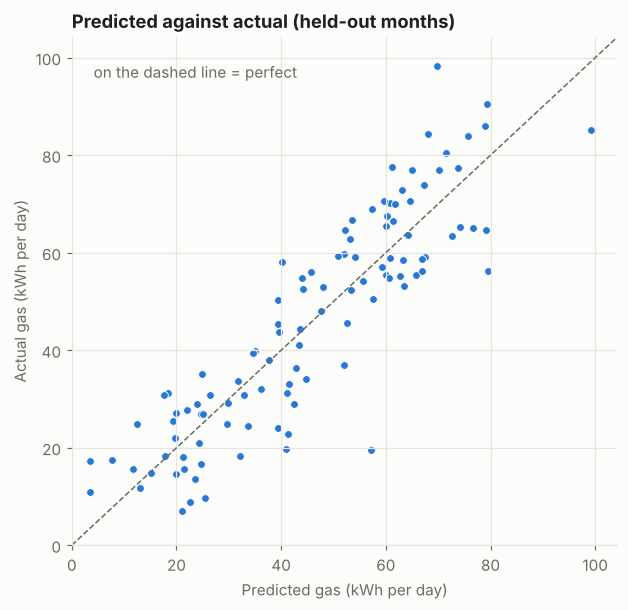

# Machine learning on my heating data, part 1: the whole house

*November 2026. The first write-up of the analysis in [`analysis/`](../analysis/). Detailed figures, charts and the most surprising days are on the [results page](../analysis/results/01_energy_signature.md); terms are explained in the [glossary](../analysis/GLOSSARY.md).*

## The question

How much gas *should* my house burn on a given day, for the weather?

If a model can answer that well, it does two jobs. It describes the house in a few physical numbers: how fast it loses heat, how much the wind and sun matter, what hot water costs. And it gives a **yardstick**: when I change something, I can compare the gas actually used with what the model expected, and see whether the change made a difference. The first change to test is already in place: new blinds in three bedrooms.

I'm a programme manager, not a data scientist. I set the questions, the rules and the checks. The code was written by Claude, an AI coding agent, under my direction, and reviewed by me before every merge (see [How this was built](../README.md#how-this-was-built)).

## The data

- **Gas:** half-hourly readings from the smart meter, collected by this app. A day counts only if all 48 half-hours are present; missing days are left out, never guessed.
- **Weather:** hourly outdoor temperature, wind and sunshine from Open-Meteo.
- **107 complete heating-season days** from two autumns and one winter (October 2025 to October 2026).
- **Limits:** the room-level history from last winter was lost with the old logger, the meter's history has whole months missing, and the boiler is a combi, so the gas figure includes hot water, which the weather can't explain.

## The approach

Three rules, set before any model was fitted:

1. **Beat a simple baseline first.** The baseline says every day uses the average amount of gas. Any model has to beat it clearly before it's believed.
2. **Test on data the model hasn't seen.** Each month was held out in turn, the model was trained on the other months, and it predicted the held-out month. Whole months, not random days, because neighbouring days share the same weather and would give the answer away.
3. **The numbers must make physical sense.** Colder weather has to cost more gas, sunshine has to save gas, and predictions can never drop below what hot water alone uses.

The models get steadily richer: degree-days (a standard measure of how cold a day is), then a learned *balance temperature* (the outdoor temperature where heating starts), then wind, sunshine and weekends.

*Each dot is one day. Colder days use more gas, in a roughly straight line, down to a floor of hot water on warm days.*

## How well it predicts

| Model | Typical daily miss |
|---|---:|
| Every day is average (baseline) | 21.2 kWh |
| Degree-days | 11.5 kWh |
| Plus a learned balance temperature | 11.4 kWh |
| **Plus wind, sunshine and weekends** | **8.5 kWh** |

The full model's typical miss is **60% smaller than the baseline's**, on months it never saw. In the usual measure for energy models (CV(RMSE)) it scores 23% on daily data.

## Where the model was wrong, and how a fact about the house fixed it

The first versions learned hot water from the data and put it at **8 to 14 kWh a day**. That looked too high. Hot water is the gas a day uses whatever the weather, and in winter there are few days mild enough to show it, so the model was extrapolating.

Two things I knew about the house fixed it:

- **Hot water drops to zero when we're away.** Days with almost no gas are now treated as days away and left out, because the model is meant to predict a normal day at home.
- **Hot water can be measured directly.** On warm days with the heating off, all the gas is hot water. Fifteen such days gave about **3.5 kWh a day**.

Fixing hot water at the measured figure, instead of letting the model guess, gave the **best score on unseen months** and tighter estimates for everything else. The lesson: a model fitted to the data still needs someone who knows the system to check whether its numbers are believable.

## What it found

- Each degree of cold over a day costs about **4.6 kWh** of gas. That's a heat-loss figure of roughly **170 W/K** for the house: useful for before-and-after comparisons, not for comparing with other houses.
- **Wind** adds to heat loss when it's cold: on a day averaging about 9 °C outside, 5 m/s more wind costs about **12 kWh** extra.
- **Sunshine** saves gas, probably through the conservatory's glass.
- **Weekends** use noticeably more gas than weekdays in the same weather, simply because people are at home.
- Heating is needed below roughly **19 °C** outside (daily average). This one is approximate: it trades off against the hot-water figure.

**An open question:** October 2026 used **about 30% less gas** than last winter's pattern predicts. Some of that is the start of the heating season being fuzzy, but not all of it. It isn't explained yet.

## What's next

1. **The blinds experiment** (running now). New blinds went into three bedrooms in October, closed overnight. With no other heating changes for about three weeks, the model's predictions become the "without blinds" yardstick for the gas actually used.
2. **Room by room.** A heat model for each room (how fast it loses heat, how much sun and wind affect it), once the floor plan is drawn.
3. **Lower radiator flow temperature**, as a second experiment, after the blinds.
4. **The same model in the cloud.** A one-off run in AWS SageMaker (training job, model registry, batch predictions), with a budget alert and everything torn down afterwards, to show how a company would run it.

## Privacy

The database never goes in this repo. The results page holds summary figures, monthly counts and a handful of individual days; no address, location or account details.
